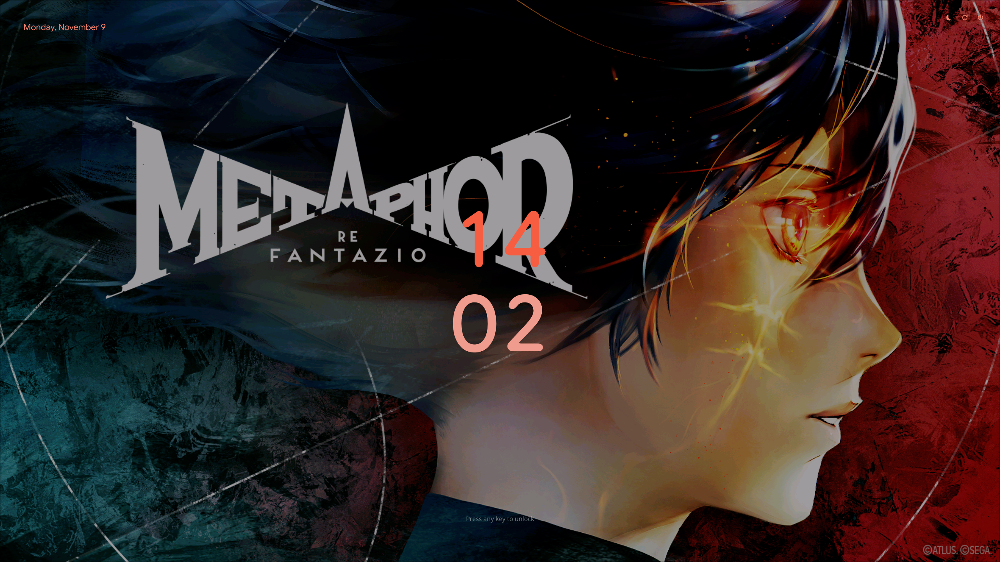
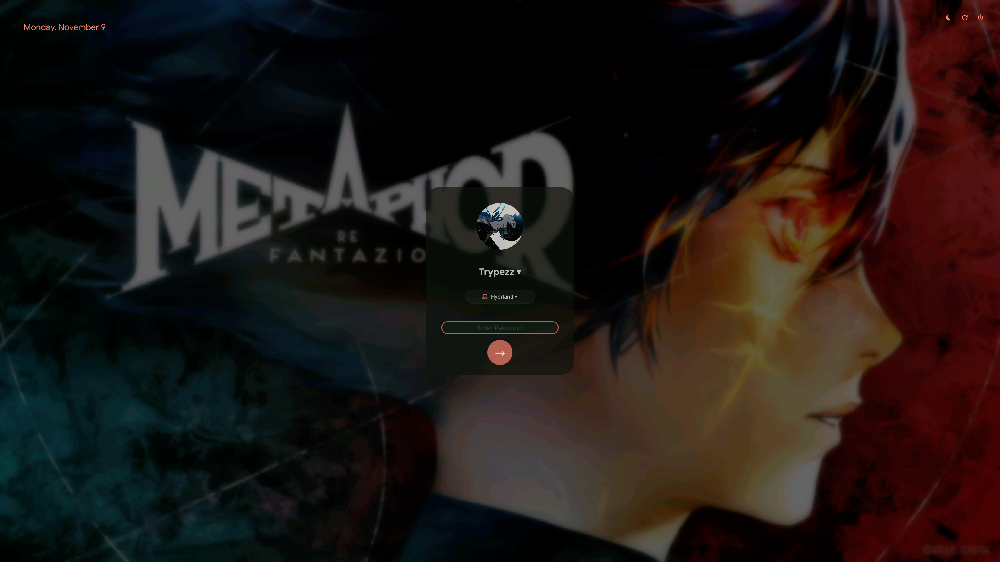
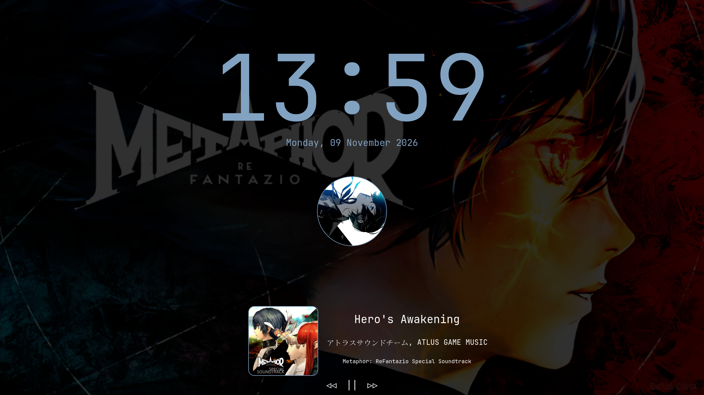
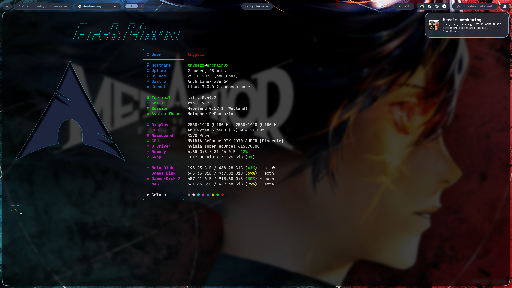
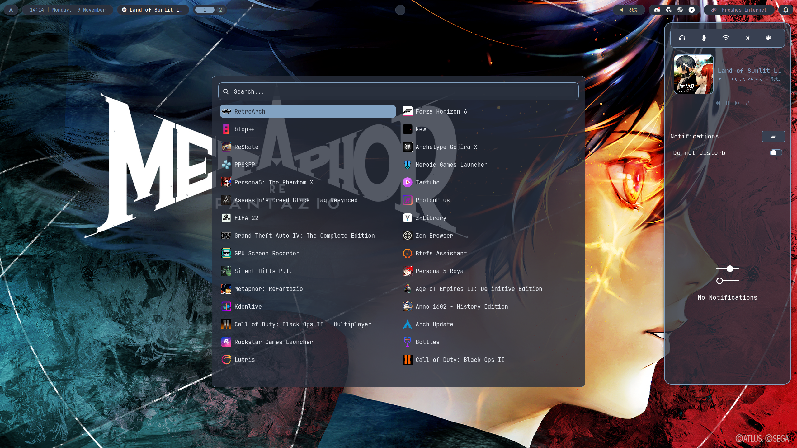
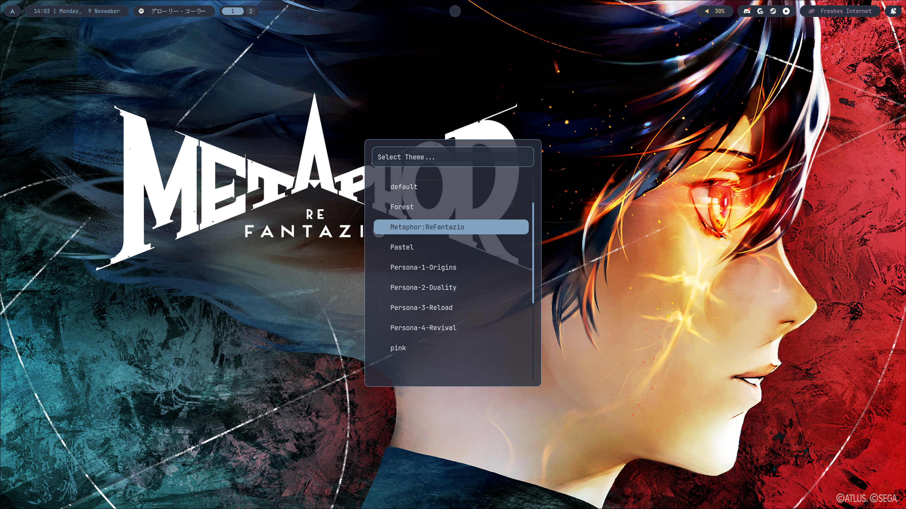
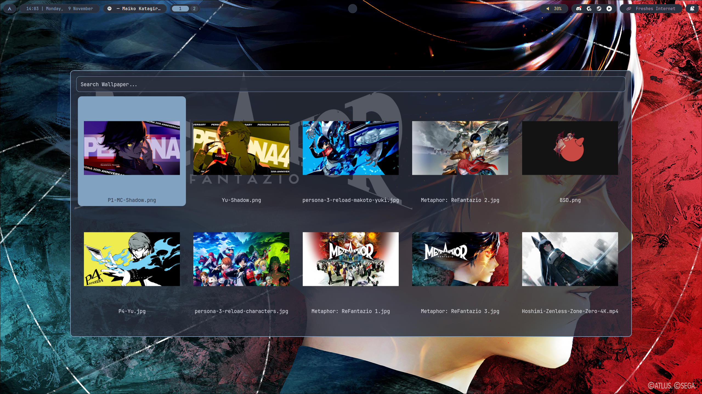

My beloved Arch + Hyprland Dotfiles :)  
Every config and bash script I wrote myself so do not expect professional things here xD

Take a look and feel free to use what you like :)

Side Note: If you want to use this repo as a base for your configs, please consider that you need to rewrite some things so it works on your system.

  <h1><strong> 📷 Screenshots </strong>
    
  </h1>

### SDDM

  
  &nbsp;&nbsp;
  

### Lockscreen

### Desktop

### Runner / Notification Center

### Theme-Switcher

### Wallpaper-Switcher

